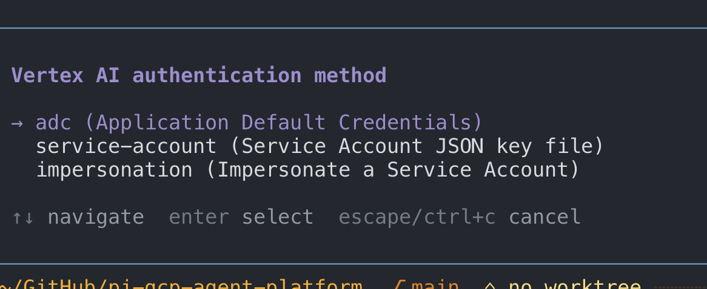

# @nilskluewer/pi-gcp-agent-platform



**Three authentication methods for Claude and Gemini on Vertex AI:**

- **ADC** — sign in with your Google user account.
- **Service Account JSON key** — select your key file.
- **Service Account impersonation** — select a target Service Account and source credentials.

Run `/setup-gemini-vertexai` to choose a method. If the selected credentials fail, requests stop instead of falling back to another authentication method.

**New in 0.4.0:** authentication-first setup, Enter to keep the current project and location, and cache settings through `/vertex-cache`. See [patch notes](./PATCH_NOTES.md).

## Overview

Use Claude and Gemini models through Google Cloud Vertex AI / Gemini Enterprise Agent
Platform in [pi](https://github.com/earendil-works/pi).

This package contains Vertex model adapters:

- `anthropic-vertex` uses Anthropic's `AnthropicVertex` client for Claude.
- `google-vertex` uses pi's native Google Vertex provider for Gemini.
- `google-vertex-images` uses Vertex AI for Gemini image generation.

All providers share the same Google Cloud project, location, credentials, and prompt-caching configuration.

## Getting Started

```bash
pi install npm:@nilskluewer/pi-gcp-agent-platform
pi
/setup-gemini-vertexai
/model google-vertex/gemini-3.5-flash-lite
```

Select Claude in the same session:

```text
/model anthropic-vertex/claude-opus-5-5
```

The legacy `/setup-vertexai` command remains available as an alias.

## Structure

```text
.
├── extensions/
│   └── gcp-agent-platform/
│       ├── index.ts       # shared setup, auth, caching, and provider registration
│       ├── anthropic.ts   # AnthropicVertex adapter for Claude
│       └── images.ts      # Vertex AI adapter for Gemini image generation
├── scripts/
│   └── smoke.mjs          # package smoke test
├── LICENSE
├── README.md
└── package.json
```

## Setup and Authentication

### Requirements

- A Google Cloud project with the Vertex AI API enabled.
- Claude and/or Gemini models enabled in Vertex AI / Gemini Enterprise Agent Platform.
- `gcloud` installed when you use Application Default Credentials (`adc`).

### Run `/setup-gemini-vertexai`

Run the setup command in pi:

```text
/setup-gemini-vertexai <google-cloud-project> [location]
```

Examples:

```text
/setup-gemini-vertexai my-project-id eu
/setup-gemini-vertexai my-project-id global
```

Run `/setup-gemini-vertexai` without arguments to open the interactive wizard. It asks for the authentication method first, then the project ID and location, followed by credential details and prompt-caching TTLs. Press Enter at the project or location prompt to keep the current value. Press Escape at these initial prompts to cancel without saving.

The wizard saves the configuration to:

```text
~/.pi/agent/gcp-agent-platform.json
```

### Authentication Options

`/setup-gemini-vertexai` supports three authentication modes:

1. **Application Default Credentials (`adc`)**
   Uses standard Google Application Default Credentials from `gcloud`:
   ```bash
   gcloud auth application-default login
   ```
2. **Service Account JSON Key (`service-account`)**
   Provide the path to a service account JSON key file (for example, `~/.config/gcp-agent/key.json`). The extension sets `GOOGLE_APPLICATION_CREDENTIALS` automatically.
3. **Service Account Impersonation (`impersonation`)**
   Provide a target service account email (for example, `sa@project.iam.gserviceaccount.com`) and an optional source key file (or use your default ADC as the source). The extension generates `~/.pi/agent/gcp-agent-platform-impersonated-adc.json` (`type: "impersonated_service_account"`) and points `GOOGLE_APPLICATION_CREDENTIALS` to it so Gemini, Claude, and Image generation use the impersonated credentials automatically.

### Environment Variables

Project and location environment variables override the saved setup at startup. An explicitly saved authentication method takes precedence over ambient credentials. The credential and cache variables below provide defaults when the corresponding saved settings are absent:

| Name | Description | Default |
|------|-------------|---------|
| `GOOGLE_CLOUD_PROJECT` | Google Cloud project ID. | Saved setup value |
| `ANTHROPIC_VERTEX_PROJECT_ID` | Claude-compatible project ID fallback. | Optional |
| `GCLOUD_PROJECT` | Google Cloud project ID fallback. | Optional |
| `GOOGLE_CLOUD_LOCATION` | Vertex region or multi-region. | Saved setup value or `eu` |
| `CLOUD_ML_REGION` | Region fallback. | Optional |
| `VERTEX_REGION` | Additional region fallback. | Optional |
| `GOOGLE_APPLICATION_CREDENTIALS` | Path to service account JSON key or generated impersonated ADC file. | Saved key path or generated impersonation file |
| `VERTEX_IMPERSONATE_SERVICE_ACCOUNT` | Target email fallback when impersonation mode is explicitly configured. Does not select impersonation mode by itself. | Saved `impersonateServiceAccount` |
| `PI_CACHE_RETENTION` | Anthropic prompt-cache retention (`short` or `long`). | Saved `anthropicCacheTtl` (`5m`) |

The package reads the former Anthropic Vertex setup file (`~/.pi/agent/anthropic-vertex-enterprise-agent-platform.json`) as a migration fallback, and writes new configuration to `~/.pi/agent/gcp-agent-platform.json`.

## Prompt & Context Caching TTLs

You can configure caching during `/setup-gemini-vertexai` or at any time with `/vertex-cache`.

### Anthropic Claude 5.5 Models (`claude-haiku-5-5`, `claude-sonnet-5-5`, `claude-opus-5-5`)

Claude models on Vertex AI use explicit `cache_control` breakpoints together with pi's background `CacheWarmer`.

Configurable TTL tiers:

- `5m` (`short`, default): 300s TTL, 1.25x cache write cost, 90-95% cache read discount ($0.01 / $0.10 / $0.20 per 1M tokens).
- `1h` (`long`): 3600s TTL (`ttl: "1h"`), 2.0x cache write cost, 90-95% cache read discount.
- `off`: Disables prompt caching.

### Gemini Models (`gemini-3.5-flash-lite`, `gemini-3.8-flash`, `gemini-4-argon`)

Gemini models on Vertex AI use **Implicit Context Caching**:

- $0 cache write cost.
- 90% cache read discount on `gemini-3.5-flash-lite` ($0.03 per 1M tokens) and `gemini-3.8-flash` ($0.075 per 1M tokens).
- 95% cache read discount on `gemini-4-argon` ($0.10 per 1M tokens).
- The extension configures the `promptCache` TTL in seconds (default `300` seconds / 5m, custom seconds, or `off`) on `gemini-3.5-flash-lite`, `gemini-3.8-flash`, and `gemini-4-argon` so pi's `CacheWarmer` keeps the implicit prefix cache warm.

### `/vertex-cache` Command Usage

```text
/vertex-cache
/vertex-cache status
/vertex-cache anthropic 1h
/vertex-cache gemini 300
```

### Example `~/.pi/agent/gcp-agent-platform.json`

```json
{
  "project": "my-gcp-project",
  "location": "eu",
  "authMode": "impersonation",
  "serviceAccountKeyPath": "~/.config/gcp-agent/source-key.json",
  "impersonateServiceAccount": "vertex-agent@my-gcp-project.iam.gserviceaccount.com",
  "anthropicCacheTtl": "1h",
  "geminiCacheTtlSeconds": 300
}
```

## Endpoints and Model Availability

| Location | Endpoint |
|----------|----------|
| `global` | `https://aiplatform.googleapis.com` |
| `eu` | `https://aiplatform.eu.rep.googleapis.com` |
| `us` | `https://aiplatform.us.rep.googleapis.com` |
| other regions | `https://<region>-aiplatform.googleapis.com` |

Model availability depends on the selected location and the Google Cloud project. For example, some Gemini models available on `global` are not available in `eu`.

## Models

Use any Claude model exposed by pi's Anthropic catalog and available in the project:

```text
/model anthropic-vertex/claude-opus-5-5
/model anthropic-vertex/claude-sonnet-5-5
/model anthropic-vertex/claude-haiku-5-5
```

Use any Gemini model exposed by pi's Google Vertex catalog and available in the project:

```text
/model google-vertex/gemini-3.5-flash-lite
/model google-vertex/gemini-3.8-flash
/model google-vertex/gemini-4-argon
```

### Image Model

`google-vertex-images/gemini-3.1-flash-image` (Nano Banana 2) is registered as a pi image model. Image models are not in `/model`; scripts reach them through the `codemode` tool (`defaultTools: ["+codemode"]`). `eu` and `global` serve it; usage counts toward session cost.
Codemode passes no options, so put settings in the prompt: `@aspect=16:9 @size=2K` (sizes `512`, `1K`, `2K`, `4K`). Images are not saved; the script must write them to disk.

```js
const m = await models.getModelOfType("image", "google-vertex-images", "gemini-3.1-flash-image");
const r = await models.generateImages(m, { input: [{ type: "text", text: "@aspect=16:9 A red fox" }] });
for (const b of r.output) if (b.type === "image") image(b);
```

Vertex AI does not support Anthropic's server-side `fallbacks` request parameter. The Claude adapter removes that Anthropic-only model metadata before sending requests.

## Run Without Installing

```bash
pi -e npm:@nilskluewer/pi-gcp-agent-platform
```

## Migration from the Standalone Packages

Use this package as the single canonical Vertex package. The former standalone Anthropic package is no longer needed in pi settings.

```bash
pi remove /path/to/pi-anthropic-vertex-enterprise-agent-platform
pi install npm:@nilskluewer/pi-gcp-agent-platform
```

`pi-vertex-gemini-search` is a separate optional web-search extension and is not part of this model package.

## Patch notes

See [PATCH_NOTES.md](./PATCH_NOTES.md) for release changes.

## License

MIT
